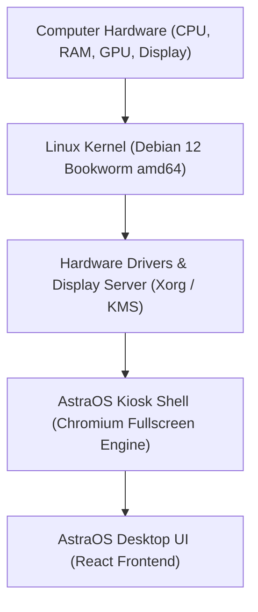

# AstraOS - Asli Bootable Operating System (Live Linux ISO)

AstraOS ko ek **asli bootable operating system** me convert karne ke liye yeh directory create ki gayi hai. Yeh bilkul **Google ChromeOS** aur **SteamOS** ke architecture par kaam karta hai:



---

## Architecture (Yeh Asli OS Kaise Kaam Karta Hai?)

1. **Bootloader (GRUB Hybrid)**:
   - Modern **UEFI** aur puraane **Legacy BIOS** dono computer par boot hota hai.
2. **Linux Kernel (vmlinuz & initrd)**:
   - Hardware detect karta hai (Wi-Fi, Audio, Graphics, Keyboard, Mouse, USB).
3. **SquashFS Live System**:
   - Compressed read-only system image jo RAM me load hoti hai bina aapki hard drive ko bina touch kiye.
4. **Auto-Login & Kiosk Mode**:
   - System on hote hi bina kisi password ya desktop window ke sidha **AstraOS** full-screen start hota hai.

---

## 🚀 ISO Download / Build Karne Ke 2 Tareeqe

### Tareeqa 1: GitHub Actions (Recommended - 1 Click, No Setup Required)

Aapko apne computer par kuch bhi heavy install karne ki zaroorat nahi hai. GitHub ke high-speed servers aapke liye `.iso` file compile karke download ke liye de denge:

1. Apne changes GitHub repository par push karein:
   ```bash
   git add .
   git commit -m "Add AstraOS Bootable OS Builder"
   git push origin astraos-custom
   ```
2. GitHub par apni repository kholein aur **Actions** tab par click karein.
3. Left menu me **Build AstraOS Bootable Live ISO** workflow chunein.
4. **Run workflow** button par click karein.
5. Workflow complete hone par **Artifacts** section se `AstraOS-v1.0-x86_64-Live-ISO` zip download kar lein (jisme aapki bootable `.iso` file hogi).

---

### Tareeqa 2: Local PC par Build Karna (WSL ya Docker)

Agar aap apne PC par ISO compile karna chahte hain:

#### Option A: WSL (Windows Subsystem for Linux)
1. PowerShell as Administrator kholein aur Ubuntu install karein:
   ```powershell
   wsl --install -d Ubuntu
   ```
2. Ubuntu terminal me repo directory me jayein:
   ```bash
   cd /mnt/c/Users/r7159/Desktop/AstraOS/win11React
   sudo chmod +x build-os/build-iso.sh
   sudo ./build-os/build-iso.sh
   ```
3. Output file `output/AstraOS-v1.0-x86_64.iso` me mil jayegi!

#### Option B: Docker
Agar aapke paas Docker Desktop installed hai:
```powershell
docker build -f build-os/Dockerfile -t astraos-builder .
docker run --privileged --rm -v "${PWD}/output:/output" astraos-builder
```

---

## 💻 ISO Ko Test Aur Use Kaise Karein?

### 1. VirtualBox / VMware me chalana:
1. VirtualBox me **New Virtual Machine** banayein.
2. Type: **Linux**, Version: **Debian (64-bit)**.
3. RAM: Kam se kam **2 GB** (4 GB recommended).
4. Storage me **Optical Drive** me `AstraOS-v1.0-x86_64.iso` select karein.
5. **Start** par click karein — PC on hote hi sidha AstraOS boot ho jayega!

### 2. Asli Laptop / PC par chalana (Pendrive se Boot):
1. Ek **8 GB ya badi USB Flash Drive** lagayein.
2. [Rufus](https://rufus.ie) download karein aur open karein.
3. USB drive select karein aur Boot selection me `AstraOS-v1.0-x86_64.iso` browse karein.
4. Partition scheme: **GPT** (UEFI) ya **MBR** (BIOS/UEFI).
5. **START** par click karein.
6. Computer restart karein aur **Boot Key** (F12, F11, ya Esc) dabakar USB select karein.
7. Aapka real computer **AstraOS** me boot ho jayega!

---

## File Structure

```text
build-os/
├── build-iso.sh          # Debian live bootstrapping, chroot config, and grub-mkrescue script
├── Dockerfile            # Containerized ISO builder
├── README.md             # Complete user guide and documentation
└── scripts/
    └── build-iso.ps1     # Windows PowerShell helper script
```
